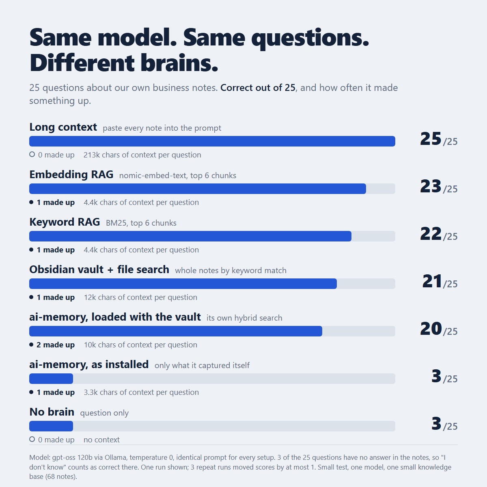

# brain-bench

**Does a "company brain" actually help your AI?** Same model, same prompt, same questions. Only the brain changes.



## What we found

We asked one free model (`gpt-oss:120b` through Ollama, temperature 0) 25 questions about our own small business. 68 Markdown notes, about 208k characters. Three of the questions had no answer in the notes, to check whether it would admit that.

| Brain | Correct /25 | Made up | Context sent per question |
|---|---|---|---|
| Long context (paste every note into the prompt) | **25** | 0 | 213k chars |
| Embedding RAG (nomic-embed-text, top 6 chunks) | 23 | 1 | 4.4k |
| Keyword RAG (BM25, top 6 chunks) | 22 | 1 | 4.4k |
| Obsidian vault + file search (whole notes) | 21 | 1 | 12k |
| ai-memory, loaded with the notes | 20 | 2 | 10k |
| ai-memory, as installed (only what it captured itself) | 3 | 1 | 3.3k |
| No brain | 3 | 0 | none |

- **No notes means mostly "I don't know".** Its 3 points are the 3 unanswerable questions.
- **Any real brain gets 20 to 25 right.** The model never changed. The notes, and how they were found, made the difference.
- **Paste-everything won, but only because the notes are small.** It sent about 50x more text than RAG. Once your notes outgrow the model's context window, RAG is the way.
- **Whole-note search lost to chunked RAG.** One long research note crowded out short, precise ones.
- **A memory tool only knows what you put in it.** As installed, it scored the same as no brain.
- **Corrections only stick when they state the fact.** We wrote one lesson per miss: 1 of 3 stuck. "Be more thorough" fixed nothing.
- **Half of the "made up" answers were incomplete lists, not inventions.**

Repeat runs moved scores by at most 1 point. This is a small test: one model, 25 questions, one small knowledge base, no tuning. Treat it as a sanity check, not a leaderboard.

## The setup we'd recommend

1. **Write short notes, one topic each.** Prices in one note, refund rules in another. Keep long research dumps in a separate folder the AI doesn't search.
2. **Small knowledge base (under roughly 100k tokens)?** Paste it all into the prompt. It's the simplest setup and it won.
3. **Bigger than that?** Use embedding RAG: chunks of about 800 characters, top 6. Keyword RAG (BM25) is a close second and needs no embedding model.
4. **Keep corrections as facts.** When the AI gets something wrong, write the correct fact into a "lessons" note it always sees: "The Growth Club costs $19 for new members", not "be careful with prices".
5. **Test it.** Write 20 questions you know the answers to (include 3 it can't know) and run this bench before you trust any setup.

## Run it yourself

Requires Node 18+ and any OpenAI-compatible chat API. The defaults use local [Ollama](https://ollama.com).

```
git clone https://github.com/kevinasorensen-alt/brain-bench
cd brain-bench
node bench.mjs
```

That runs every setup on `sample-kb/`, a made-up small business (Northwind Studio), with `questions.json`, and writes `results.json`. To test your own notes:

```
node bench.mjs --kb /path/to/your/notes --questions my-questions.json --setups none,files,bm25,embed,long
```

Settings (environment variables):
- `BENCH_API`: default `http://127.0.0.1:11434/v1`
- `BENCH_MODEL`: default `gpt-oss:120b-cloud`
- `BENCH_API_KEY`: optional
- `BENCH_EMBED_MODEL`: default `nomic-embed-text` (the embedding setup is skipped if it isn't installed)

Question format: `{ "id": "q01", "q": "...", "all": ["regex that must match"], "none": ["regex that must not"] }`, or `"unanswerable": true` for questions where "I don't know" is the right answer.

On the sample company, a quick run gives: no brain 3/20, file search, BM25 and long context 20/20, embedding RAG 17/20. The sample is deliberately easy. Your own notes are the real test.

## What's here

- `bench.mjs`: the whole benchmark, one file, no dependencies.
- `sample-kb/`: fictional notes for Northwind Studio. Any resemblance to a real business is coincidental.
- `questions.json`: 20 questions about the sample, 3 of them unanswerable.
- `results/chart.png`: the chart from our real run. Our own notes aren't published; they're a real business's private notes.

## License

MIT
